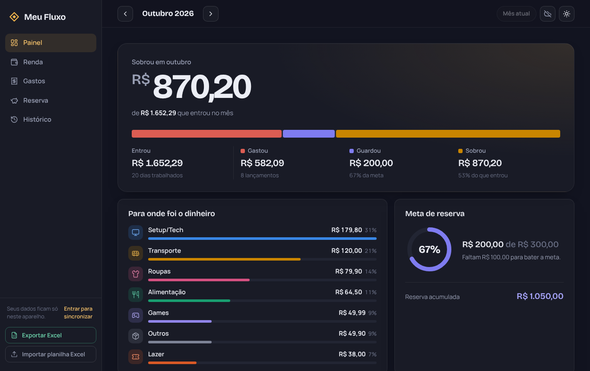
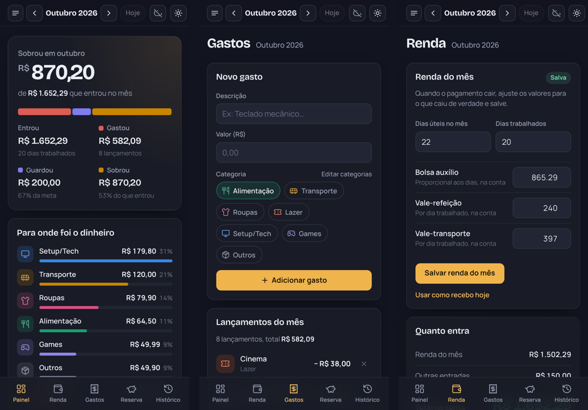

# ◈ Meu Fluxo

Aplicação web de **controle financeiro pessoal**, feita para acompanhar mês a mês quanto entrou, quanto foi gasto e quanto sobrou, com uma meta de reserva.

Projeto pessoal, criado para organizar a renda do estágio e praticar JavaScript puro. Funciona no navegador, pode ser instalado como app no celular e, se você quiser, sincroniza os dados entre o PC e o celular.

**🔗 [Abrir o Meu Fluxo](https://aangelkjpn.github.io/Fluxo_Controle_Financeiro/)**: dá para usar sem conta, com os dados salvos só no seu aparelho.

<p align="center">
  
</p>

<p align="center">
  
</p>

<p align="center"><sub>Dados fictícios, usados só para demonstração.</sub></p>

---

## Funcionalidades

### O mês num olhar
- **Painel:** quanto sobrou no mês em destaque, com uma barra mostrando como o que entrou se dividiu entre gastos, reserva e sobra
- **Para onde foi o dinheiro:** gastos por categoria, cada uma com seu ícone
- **Meta de reserva:** quanto guardar por mês, com o progresso e o total acumulado
- **Histórico:** cada mês com a sua barra de fluxo, na mesma escala, para comparar os meses

### Renda
- **Como eu recebo:** cada pessoa monta as partes do que recebe. Cada parte pode ser fixa no mês, proporcional aos dias trabalhados ou por dia trabalhado, e cair na conta ou num cartão de benefício
- **Renda do mês:** começa como estimativa e você ajusta para o valor que caiu de verdade. Cada mês guarda os valores da época, então mudar de emprego não altera o histórico
- **Cartões de benefício** (Ticket, VR, passe): saldo separado, que acumula de um mês para o outro e não entra no "Sobrou"
- **Outras entradas:** freela, 13º, presente

### Gastos
- **Categorias com ícone:** 16 prontas (Mercado, Delivery, Casa e contas, Saúde e farmácia, Beleza e cuidados, Assinaturas, Pets e outras). Cada pessoa liga só as que usa e pode criar as próprias
- **Pago com:** dinheiro ou cartão de benefício
- **Parcelas:** compras parceladas entram sozinhas nos gastos de cada mês até a última parcela, e o Painel mostra quanto vai em parcelas nos próximos 6 meses

### Seus dados
- **Sincronização entre aparelhos (opcional):** entre com e-mail e senha para ver os mesmos dados no PC e no celular
- **Funciona sem internet:** o que você lança fica salvo no aparelho e sobe quando a conexão volta
- **Excel:** exporta tudo para uma planilha (.xlsx) e importa de volta. Planilhas de versões antigas também funcionam
- **Lembrete de backup** quando passa de 30 dias sem exportar
- **App instalável (PWA)** no celular e no PC
- **Tema escuro e claro**, que segue o do sistema e pode ser trocado

---

## Tecnologias


- **HTML, CSS e JavaScript** puros, sem framework de JavaScript
- **Bootstrap 5** para o grid responsivo, formulários, janelas, notificações e o menu lateral no celular
- **ExcelJS** para gerar e ler as planilhas
- **localStorage** para salvar os dados no navegador
- **Supabase** (Postgres + login) para sincronizar entre aparelhos, com Row Level Security para que cada conta só acesse os próprios dados
- **Service worker + manifest** para o app abrir sem internet e poder ser instalado

As bibliotecas ficam na pasta `libs/`, então o app não depende de nenhum site externo para abrir (só as fontes vêm do Google Fonts).

---

## Como usar

**Online:** abra o [link do app](https://aangelkjpn.github.io/Fluxo_Controle_Financeiro/). Na primeira vez, toque em **Renda → Configurar minha renda** para contar como você recebe.

**No seu computador:**

1. Baixe ou clone o repositório:
   ```bash
   git clone https://github.com/aangelkjpn/Fluxo_Controle_Financeiro.git
   ```
2. Abra o arquivo `index.html` no navegador.

Não precisa instalar nada. Para testar o modo app (PWA), sirva a pasta por um servidor local, como o Live Server do VS Code.

### Instalar como app

- **Android (Chrome):** toque em **Instalar app** no menu lateral, ou em ⋮ → *Instalar app*.
- **iPhone (Safari):** toque em **Compartilhar** → **Adicionar à Tela de Início**. No iPhone, o app instalado guarda os dados separado do Safari, então entre na sua conta dentro do app.
- **PC (Chrome/Edge):** clique no ícone de instalar na barra de endereço.

### Sincronizar entre aparelhos

Toque no ícone de nuvem no topo e entre, ou crie uma conta. A partir daí, o que você lançar num aparelho aparece nos outros em que estiver logado.

- **Sem conta**, tudo fica só no navegador daquele aparelho.
- **Na primeira vez que você entra**, os dados que já estavam no aparelho são juntados com os da conta.
- **Ao sair da conta**, os dados são apagados daquele aparelho, mas continuam salvos na conta.
- Cada conta só vê os próprios dados.

### Usar com o seu próprio Supabase

Se você fizer um fork, a sincronização continua apontando para o Supabase deste projeto. Para usar o seu:

1. Crie um projeto em [supabase.com](https://supabase.com) e rode o [`docs/banco.sql`](docs/banco.sql) no **SQL Editor**.
2. Em **Authentication → URL Configuration**, coloque o endereço do seu site em **Site URL**.
3. Troque `SUPABASE_URL` e `SUPABASE_KEY` no começo de `js/sync.js` pela URL e pela chave *publishable* do seu projeto.

---

## Estrutura

```
├── index.html            # Estrutura das abas (Painel, Renda, Gastos, Reserva, Histórico)
├── style.css             # Estilos (tema escuro e claro)
├── manifest.webmanifest  # Nome, cores e ícones do app instalado
├── sw.js                 # Service worker: deixa o app abrir sem internet
├── js/
│   ├── app.js            # Painel, gastos, reserva, histórico e armazenamento
│   ├── categorias.js     # Ícones, catálogo e "Minhas categorias"
│   ├── renda.js          # "Como eu recebo", renda do mês e cartões de benefício
│   ├── parcelas.js       # Compras parceladas
│   ├── excel.js          # Exportar e importar a planilha Excel
│   └── sync.js           # Login e sincronização com o Supabase
├── icons/                # Ícones do app
├── docs/
│   ├── banco.sql         # Estrutura do banco no Supabase
│   └── *.png             # Imagens deste README
└── libs/                 # Bootstrap, ExcelJS e Supabase
```

---

## Observações

- Sem conta, os dados ficam salvos **apenas no seu navegador**. Com conta, uma cópia fica no Supabase, protegida para que só você acesse.
- Use **Exportar Excel** de vez em quando para ter um backup. A planilha tem as abas *Lançamentos*, *Renda*, *Meses*, *Parcelas*, *Como eu recebo*, *Categorias* e *Configurações*, que podem ser importadas de volta. A aba *Resumo* é só para leitura.
- Importar substitui os meses que estão no arquivo; os outros meses não são alterados. A configuração de renda, as parcelas e as categorias são substituídas pelas do arquivo.

---

Desenvolvido por [Angelo Gabriel](https://github.com/aangelkjpn)
